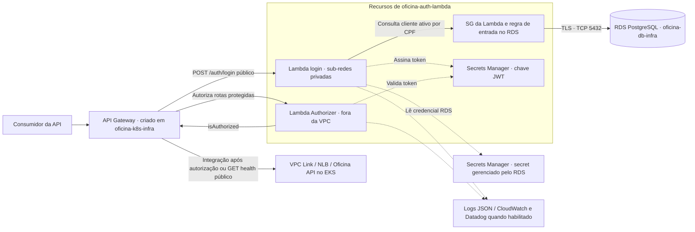

# Oficina — Autenticação serverless

Login por CPF e Lambda Authorizer em Python 3.13, com JWT HS256, consulta ao RDS e definição das rotas do API Gateway. O deploy depende de oficina-k8s-infra e oficina-db-infra; o login funcional depende também das migrations da API.

## Contexto e objetivo

O atendimento da oficina usa dados de clientes, veículos, estoque e ordens de serviço. Na implantação AWS, a entrada para essas operações passa pelo API Gateway, com identificação do cliente e validação do token antes do encaminhamento à aplicação.

Este repositório implementa o login por CPF e o Lambda Authorizer. O login consulta o cadastro ativo no PostgreSQL, emite JWT e permite que o cliente da API reutilize o token no ciclo de diagnóstico, orçamento, execução, pagamento e entrega. As regras dessas operações continuam na API Java.

## Navegação

Os guias abaixo complementam este README com instruções de execução, configuração e diagnóstico.

**Guias e documentos complementares**

- [Instalação das ferramentas](https://github.com/tc-organization-26/gestao-oficina-tc-1/blob/HEAD/docs/INSTALACAO-FERRAMENTAS.md) — instalar ferramentas e conferir o ambiente.
- [Conta AWS comum](https://github.com/tc-organization-26/oficina-k8s-infra/blob/HEAD/docs/CONTA-AWS-COMUM.md) — preparar IAM, OIDC e adaptar a execução fora do Academy.
- [Validação local e execução manual](docs/VALIDACAO-E-EXECUCAO-MANUAL.md) — validação e execução pelo terminal.
- [Execução no laboratório AWS](docs/EXECUCAO-LAB-AWS.md) — checklist GitHub, dependências, deploy e encerramento.
- [Tecnologias e versões](docs/VERSOES.md) — tecnologias, ferramentas, versões e fontes.
- [Troubleshooting](docs/TROUBLESHOOTING.md) — diagnóstico por assunto e recuperação.

**Seções deste README**

- [Valor para o projeto](#valor-para-o-projeto)
- [Execução e deploy](#execução-e-deploy)
- [Arquitetura e fluxo de autenticação](#arquitetura)
- [Participação no atendimento](#participação-no-atendimento)
- [Limites do mecanismo atual](#limites-do-mecanismo-atual)
- [Caminho da implantação](#caminho-da-implantação)
- [Contrato e exemplos de login](#acesso-à-api)
- [Validação integrada](#validação-integrada)
- [Troubleshooting](#troubleshooting)

## Valor para o projeto

- login integrado ao cadastro ativo de clientes usado pela oficina;
- emissão de JWT com validade e identidade do cliente;
- rejeição de chamadas sem token válido nas rotas protegidas do Gateway;
- chave de assinatura compartilhada com a API pelo Secrets Manager;
- funções e rotas provisionadas por Terraform, com testes e deploy no GitHub Actions;
- logs e instrumentação para investigar falhas de login, banco e autorização.

## Responsabilidades deste repositório

- normalizar e validar o CPF e consultar se o cliente está ativo no RDS;
- emitir JWT HS256 e validar tokens no Lambda Authorizer;
- configurar as rotas públicas de login e saúde e as rotas protegidas do Gateway;
- criar o Security Group da Lambda de login e sua regra de acesso ao RDS;
- empacotar os handlers Python com o driver PostgreSQL;
- publicar logs estruturados e habilitar layers Datadog quando a configuração compartilhada estiver disponível.

## Repositórios da solução

| Repositório | Responsabilidade |
| --- | --- |
| [gestao-oficina-tc-1](https://github.com/tc-organization-26/gestao-oficina-tc-1#readme) | API Java, migrations, Docker Compose e deploy da aplicação |
| [oficina-k8s-infra](https://github.com/tc-organization-26/oficina-k8s-infra#readme) | Bootstrap, rede, EKS, escalabilidade e entrada HTTP |
| [oficina-db-infra](https://github.com/tc-organization-26/oficina-db-infra#readme) | RDS PostgreSQL privado, backups e credencial gerenciada |
| [oficina-auth-lambda](https://github.com/tc-organization-26/oficina-auth-lambda#readme) | Login por CPF, JWT e rotas protegidas do Gateway |

## Dependência obrigatória

Execute primeiro `oficina-k8s-infra` e `oficina-db-infra`, no mesmo ambiente.

Este Terraform lê os seguintes parâmetros do AWS Systems Manager Parameter Store. `ENV` deve ser o mesmo ambiente da rede, do banco e da API:

```text
/oficina/ENV/edge/http-api-id
/oficina/ENV/edge/http-api-execution-arn
/oficina/ENV/edge/app-integration-id
/oficina/ENV/network/vpc-id
/oficina/ENV/network/private-subnet-ids
/oficina/ENV/database/endpoint
/oficina/ENV/database/port
/oficina/ENV/database/name
/oficina/ENV/database/security-group-id
/oficina/ENV/database/master-secret-arn
```

Se esses parâmetros não existirem para o ambiente selecionado, o `terraform plan` falhará antes de criar as funções. O deploy da autenticação pode ocorrer antes da API; o login por CPF depende também do primeiro startup da API com o Flyway concluído.

## Execução e deploy

### Validação local e execução manual

Consulte o [guia de validação local e execução manual](docs/VALIDACAO-E-EXECUCAO-MANUAL.md) para executar testes, montar o pacote e validar o Terraform. Os testes usam Python 3.13 e mocks, sem AWS ou banco real. O pacote deve conter os módulos de `src/` e as dependências de `requirements.txt`.

O Terraform fica em `terraform/` e empacota `../package`. Este repositório não fornece servidor HTTP local; o Compose da aplicação executa o login Java com `login` e `senha`.

### Deploy e execução no laboratório AWS

Prepare o [checklist de acessos e configurações](docs/EXECUCAO-LAB-AWS.md#checklist-inicial) e conclua as dependências na [ordem de implantação](docs/EXECUCAO-LAB-AWS.md#ordem-da-primeira-implantação). Faça o merge para `homologacao` para disparar o deploy em `hom` e aguarde a conclusão. Para produção, use `main` após validar homologação. **Run workflow é uma alternativa ou reexecução**, não um passo obrigatório após o merge.

> O código contém adaptações educacionais de IAM e credenciais. Confira a observação do guia AWS antes de utilizá-lo em outra conta.

Conclua plataforma e RDS no mesmo ambiente. O workflow valida o Python, monta o pacote, aplica Terraform e grava `JWT_SECRET` no Secrets Manager. A API é implantada depois para executar Flyway; só então teste o CPF. Reexecute a autenticação após o primeiro deploy da API para habilitar Datadog com o secret compartilhado.

## Arquitetura



Consulte os [recursos principais](#recursos-principais) deste componente. A [arquitetura integrada da aplicação](https://github.com/tc-organization-26/gestao-oficina-tc-1/blob/HEAD/docs/ARQUITETURA-SOLUCAO.md) reúne os quatro projetos e suas sequências.

## Arquitetura provisionada

Este repositório configura as rotas de login, saúde e aplicação no Gateway existente. O Authorizer retorna a decisão de acesso; a integração do Gateway encaminha a chamada à API.

## Fluxo de autenticação

O Gateway entrega `POST /auth/login` à Lambda de login, que valida o CPF, consulta o cliente ativo no RDS e emite JWT. Nas chamadas protegidas, a Lambda Authorizer valida o token e devolve a decisão ao Gateway; o Gateway encaminha a requisição pelo VPC Link/NLB à API, que também valida o JWT no Spring Security.

São públicas as rotas `POST /auth/login`, `GET /actuator/health` e `GET /actuator/health/readiness`. As rotas `ANY /` e `ANY /{proxy+}` usam autorização `CUSTOM`, inclusive para Swagger/OpenAPI. Os [diagramas de sequência](https://github.com/tc-organization-26/gestao-oficina-tc-1/blob/HEAD/docs/ARQUITETURA-SOLUCAO.md#sequência-de-autenticação) ficam no documento de arquitetura da solução.

## Participação no atendimento

1. A API inicia e aplica as migrations Flyway, disponibilizando o cadastro de cliente ativo usado no teste.
2. O consumidor chama `POST /auth/login` com `cpf` pela URL do Gateway.
3. A Lambda valida o formato e os dígitos do CPF, consulta o cliente no RDS privado e verifica se está ativo.
4. O login retorna JWT; o consumidor envia `Authorization: Bearer TOKEN` nas operações de negócio.
5. O Authorizer valida o token e devolve a decisão ao Gateway. O Gateway encaminha as chamadas aceitas para a API via VPC Link e NLB.
6. O Spring Security valida o JWT novamente; os casos de uso executam as regras da oficina e persistem os dados.

O token permite chamar a API; ele não aprova orçamento, registra pagamento ou altera status automaticamente. Veja o [fluxo completo de atendimento](https://github.com/tc-organization-26/gestao-oficina-tc-1#fluxo-de-atendimento) e o [roteiro Insomnia](https://github.com/tc-organization-26/gestao-oficina-tc-1/blob/HEAD/docs/VALIDACAO-FLUXO.md) para a demonstração do negócio.

## Limites do mecanismo atual

O login por CPF é o mecanismo de demonstração do projeto. Ele verifica a existência e a situação do cadastro, mas não comprova posse de senha ou segundo fator. O JWT contém `papel=CLIENTE`; as rotas de negócio do Java exigem autenticação, sem regras por papel ou comparação automática entre o `sub` do token e o cliente informado na requisição.

Portanto, os atores cliente, atendente, mecânico e gestor descrevem o processo da oficina, sem representar perfis com permissões distintas já implementadas. A recusa de um token e a validação das regras de uma ordem de serviço são verificações diferentes.

| Ambiente | Quem atende o login | Corpo |
| --- | --- | --- |
| AWS pelo API Gateway | Lambda de login | `{"cpf":"00361937040"}` |
| Compose ou acesso direto ao Java | Controller da API | `{"login":"admin","senha":"ad@456"}` |

A credencial Java é fictícia e serve ao desenvolvimento local. A collection da API deve ser ajustada ao ambiente antes de executar a demonstração. Não use o corpo de login Java na rota Lambda nem o CPF no controller Java.

## Caminho da implantação

```text
Bootstrap e plataforma: rede, Gateway e integração HTTP
  → RDS: banco privado e credencial gerenciada
  → autenticação: pacote Python, funções, secret JWT e rotas
  → workflow gravar a chave JWT no Secrets Manager
  → API: copiar configurações, iniciar e executar Flyway
  → reexecutar autenticação para habilitar Datadog com o secret da API
  → validar readiness, login, chamada protegida e fluxo de OS
```

A primeira implantação da autenticação pode ocorrer antes das tabelas, mas o login só deve ser testado depois do Flyway. Se o secret Datadog ainda não existe, a esteira publica sem tracer e orienta a reexecução após a API. As dependências e os acessos estão no [guia AWS](docs/EXECUCAO-LAB-AWS.md).

## Recursos principais

| Recurso | Finalidade |
| --- | --- |
| `aws_lambda_function.login` | Valida CPF, consulta o cliente e emite JWT |
| `aws_lambda_function.authorizer` | Valida Bearer JWT no API Gateway |
| `aws_security_group.login_lambda` | Identidade de rede da Lambda de login |
| `aws_vpc_security_group_ingress_rule.database_from_login_lambda` | Libera Lambda → RDS na porta do banco |
| `aws_secretsmanager_secret.auth` | Armazena a chave JWT |
| `aws_apigatewayv2_integration.login` | Integra `POST /auth/login` à Lambda |
| `aws_apigatewayv2_authorizer.jwt` | Protege as rotas da aplicação |
| `archive_file.function` | Empacota handler e driver PostgreSQL |

## Acesso à API

- [Collection Insomnia da autenticação](docs/insomnia/collection.json): configure `BASE_URL`, execute login e copie o token retornado para `TOKEN`.

- [Collection completa da Oficina API](https://github.com/tc-organization-26/gestao-oficina-tc-1/blob/HEAD/src/main/docs/insomnia/collection.yaml): requisições para os demais fluxos, em formato Insomnia.

O Swagger Java descreve o login interno `{login, senha}`; o contrato abaixo descreve o login por CPF atendido pela Lambda na nuvem. Os exemplos HTTP podem ser reproduzidos no Insomnia; o [guia AWS](docs/EXECUCAO-LAB-AWS.md#validar-as-funções-e-o-login) traz o teste em PowerShell.

### Login

```http
POST /auth/login
Content-Type: application/json
```

O CPF pode ser enviado somente com dígitos ou com pontuação. O login por CPF é uma demonstração e não comprova posse de senha ou segundo fator. A API oferece cadastro de clientes; o exemplo abaixo usa o cliente fictício criado pelo Flyway para testes e demonstrações:

```json
{
  "cpf": "003.619.370-40"
}
```

Resposta de sucesso:

```json
{
  "token": "eyJ..."
}
```

| Status | Situação |
| --- | --- |
| `200` | CPF válido, cliente existente e ativo; JWT emitido |
| `400` | Corpo inválido ou CPF com formato/dígitos verificadores inválidos |
| `403` | Cliente encontrado, porém inativo |
| `404` | Nenhum cliente encontrado para o CPF |
| `500` | Falha inesperada ao consultar dependências |

### Chamada protegida

```http
GET /clientes
Authorization: Bearer eyJ...
```

Token ausente, adulterado ou expirado é recusado pelo Lambda Authorizer.

## Estrutura do repositório

| Arquivo ou diretório | Responsabilidade |
| --- | --- |
| [src/handler.py](src/handler.py) | Login CPF, consulta PostgreSQL, emissão e validação de JWT |
| [src/observability.py](src/observability.py) | Logs estruturados, duração e observação das integrações |
| [requirements.txt](requirements.txt) | Dependências Python empacotadas com os handlers |
| [tests/](tests) | Testes unitários de autenticação e observabilidade |
| [terraform/main.tf](terraform/main.tf) | Funções, pacote ZIP, rede, secret JWT e rotas/Authorizer |
| [terraform/datadog.tf](terraform/datadog.tf) | Layers e instrumentação das Lambdas |
| [terraform/variables.tf](terraform/variables.tf), [versions.tf](terraform/versions.tf) e [outputs.tf](terraform/outputs.tf) | Entradas, providers e saídas do Terraform |
| [.github/workflows/cicd.yml](.github/workflows/cicd.yml) | Testes, pacote, deploy, atualização do secret e promoção |
| [docs/insomnia/collection.json](docs/insomnia/collection.json) | Readiness, login e chamada protegida |

## JWT

O token é assinado com HMAC SHA-256 (`HS256`) e possui validade padrão de 3600 segundos.

| Claim | Conteúdo |
| --- | --- |
| `sub` | UUID do cliente retornado pelo banco |
| `papel` | `CLIENTE` |
| `iat` | Instante de emissão |
| `exp` | Instante de expiração |

O mesmo `JWT_SECRET` é entregue à aplicação no EKS, permitindo que o Spring Security valide o token depois da autorização no Gateway.

## Consulta ao banco

A Lambda executa uma consulta parametrizada equivalente a:

```sql
SELECT id, ativo
FROM cliente
WHERE cpf_cnpj = ?;
```

O acesso usa `pg8000`, um driver PostgreSQL Python empacotado junto da função. As credenciais não ficam no código nem no state deste repositório: são lidas do secret gerenciado pelo RDS.

O CPF é armazenado sem pontuação. A identificação do [cliente inicial de teste](https://github.com/tc-organization-26/gestao-oficina-tc-1/blob/HEAD/docs/ARQUITETURA-SOLUCAO.md#contratos-segurança-e-persistência) fica documentada junto das migrations da API. O login só funciona depois do primeiro startup da API com o Flyway concluído.

## Rede e segurança

O Terraform:

- coloca a Lambda de login nas sub-redes privadas da VPC;
- cria um security group exclusivo para a Lambda;
- libera no security group do RDS somente tráfego TCP da Lambda para a porta publicada pelo banco, normalmente `5432`;
- mantém o RDS privado;
- utiliza conexão TLS com o PostgreSQL;
- mantém a Lambda Authorizer fora da VPC, pois ela precisa somente validar o JWT e acessar o Secrets Manager.

As sub-redes privadas precisam de saída para o Secrets Manager. A infraestrutura Kubernetes habilita NAT Gateway por padrão através de `enable_nat_gateway = true`.

No ambiente educacional, as funções reutilizam a `LabRole`. Ela precisa permitir criação e remoção de interfaces de rede da Lambda, leitura dos parâmetros SSM e leitura dos secrets utilizados.

## Configuração Terraform e descoberta

As variáveis são declaradas em [variables.tf](terraform/variables.tf) e [datadog.tf](terraform/datadog.tf).

| Variável | Padrão | Uso |
| --- | --- | --- |
| `aws_region` | `us-east-1` | Região dos recursos |
| `project_name` | `oficina` | Prefixo de nomes e caminhos SSM |
| `environment` | `dev` | Informe `hom` ou `prod` ao integrar com o CI/CD |
| `lab_role_arn` | Obrigatória, sem padrão | Role preexistente das funções |
| `jwt_expiration_seconds` | `3600` | Validade do JWT em segundos |
| `database_connect_timeout_seconds` | `5` | Timeout da conexão PostgreSQL em segundos |
| `datadog_enabled` | `false` | Ativa instrumentação nas duas funções |
| `datadog_site` | `datadoghq.com` | Site da conta Datadog |
| `datadog_version` | `local` | Versão de telemetria; no Actions recebe o SHA |
| `datadog_python_layer_version` | `127` | Layer Python 3.13 |
| `datadog_extension_layer_version` | `99` | Layer da extensão Datadog |
| `datadog_api_key_secret_arn` | Vazio | Obrigatório quando Datadog estiver habilitado |

Os [outputs](terraform/outputs.tf) são `login_function_name`, `authorizer_function_name`, `auth_secret_arn` e `login_lambda_security_group_id`. O secret `oficina-ENV/auth` contém somente `jwtSecret`; o workflow grava o valor após o apply. `AUTH_LOGIN`, `AUTH_PASSWORD` e `ADMIN_ID` não são utilizados.

A autenticação usa `oficina/auth/hom.tfstate` ou `oficina/auth/prod.tfstate`. Use o mesmo ambiente da plataforma, do banco e da aplicação.

## Validação após o deploy

Confirme que as funções estão ativas, aguarde o Flyway da API e siga o [teste de login e rota protegida](docs/EXECUCAO-LAB-AWS.md#validar-as-funções-e-o-login). O CPF fictício `003.619.370-40` deve retornar JWT após o seed; uma chamada sem token a `/clientes` deve ser recusada.

Os outputs são `login_function_name`, `authorizer_function_name`, `auth_secret_arn` e `login_lambda_security_group_id`. Falhas de CPF, rede, secrets e Authorizer estão divididas por assunto no [troubleshooting](docs/TROUBLESHOOTING.md).

## Validação integrada

Use a [collection deste componente](docs/insomnia/collection.json) para validar readiness, login por CPF e chamada protegida. Depois, importe a [collection de negócio da API](https://github.com/tc-organization-26/gestao-oficina-tc-1/blob/HEAD/src/main/docs/insomnia/collection.yaml) para executar a pasta **FLUXO COMPLETO** conforme o [roteiro de demonstração](https://github.com/tc-organization-26/gestao-oficina-tc-1/blob/HEAD/docs/VALIDACAO-FLUXO.md).

| Cenário | Resultado esperado |
| --- | --- |
| Cliente ativo e CPF válido | `200` com `token` |
| CPF inválido | `400` |
| CPF válido sem cadastro | `404` |
| Cliente inativo | `403` |
| Rota protegida sem JWT válido | Acesso recusado antes da operação de negócio |
| JWT válido e requisição de negócio válida | Resposta da API conforme o contrato da operação |

Use dados de teste preparados para cada cenário. Falhas de infraestrutura, secrets ou banco podem retornar `500` e devem ser investigadas nos logs; não significam necessariamente CPF recusado. Para acompanhar a autenticação após habilitar Datadog, filtre as funções pelo ambiente e confirme a coleta conforme o guia de observabilidade.

## Observabilidade

Os handlers emitem logs JSON com identificador, duração e resultado, além de `dd.trace_id`/`dd.span_id` quando o tracer está ativo. O login devolve `X-Request-ID`; CPF, JWT, senhas e corpo da requisição não são registrados. Falhas PostgreSQL/Secrets Manager geram `integration.failed` e respostas 500 marcam o trace como erro.

A esteira descobre o secret `oficina-ENV/datadog`, alimentado pela API, e habilita as layers `Datadog-Python313:127` e `Datadog-Extension:99` (x86_64). Se o secret ainda não existir, publica sem tracer e emite um aviso; após o deploy da API, reexecute a Lambda. A `LabRole` precisa ler o secret e acessar as layers; o login precisa de saída HTTPS pelo NAT. A variável opcional `DD_SITE` deve corresponder à conta usada pela API.

Não é necessário duplicar `DD_API_KEY`/`DD_APP_KEY` neste repositório. A configuração compartilhada, dashboards, monitores e limites de correlação estão no [guia Datadog da API](https://github.com/tc-organization-26/gestao-oficina-tc-1/blob/HEAD/docs/OBSERVABILIDADE.md). Para consultar as funções, filtre `env:hom (service:oficina-login OR service:oficina-authorizer)`.

## Encerramento

Remova a API antes da autenticação e este componente antes do RDS/Gateway, seguindo o [encerramento](docs/EXECUCAO-LAB-AWS.md#encerramento). A exclusão do secret JWT não tem janela de recuperação no código atual. Uma recriação precisa publicar a chave e atualizar os consumidores consistentemente.

## Workflow

- [Workflow deste componente](.github/workflows/cicd.yml).
- [Histórico de execuções](https://github.com/tc-organization-26/oficina-auth-lambda/actions/workflows/cicd.yml).

### Fluxo de branches

`fase-3` valida e abre PR para `homologacao`; `homologacao` faz deploy em `hom` e abre PR para `main`; `main` faz deploy em `prod`. Os merges são manuais. Executar manualmente em `fase-3` também só valida. Consulte [branches e ambientes](docs/EXECUCAO-LAB-AWS.md#branches-e-ambientes).

## Troubleshooting

Consulte o [guia de diagnóstico deste componente](docs/TROUBLESHOOTING.md) para sintomas, comandos de verificação e correções por assunto. O guia também referencia os demais componentes quando a falha atravessa rede, banco, autenticação ou aplicação.
