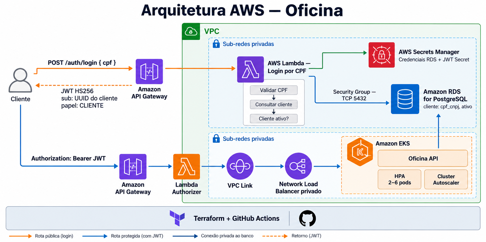

# Oficina — Lambda de autenticação por CPF

Componente serverless responsável por autenticar clientes por CPF, consultar sua existência e seu status no PostgreSQL gerenciado e emitir o JWT usado nas APIs protegidas da Oficina.



## Fluxo de autenticação

```text
POST /auth/login { cpf }
  -> Amazon API Gateway
     -> Lambda login em sub-redes privadas
        -> valida formato e dígitos verificadores do CPF
        -> lê as credenciais do RDS no Secrets Manager
        -> consulta cliente por cpf_cnpj
        -> exige cliente existente e ativo
        -> emite JWT HS256 com sub=<UUID do cliente> e papel=CLIENTE

Authorization: Bearer <JWT>
  -> API Gateway
     -> Lambda Authorizer
        -> valida assinatura e expiração
        -> encaminha a requisição ao NLB privado e à aplicação no EKS
```

O login é a única rota pública. As rotas `ANY /` e `ANY /{proxy+}` usam autorização `CUSTOM`.

## Contrato da API

### Login

```http
POST /auth/login
Content-Type: application/json
```

O CPF pode ser enviado somente com dígitos ou com pontuação. Enquanto o sistema ainda não possui cadastro de clientes, o exemplo abaixo utiliza um CPF fictício criado pela migration exclusivamente para testes e demonstrações:

```json
{
  "cpf": "003.619.370-40"
}
```

Resposta de sucesso:

```json
{
  "token": "eyJ..."
}
```

| Status | Situação |
| --- | --- |
| `200` | CPF válido, cliente existente e ativo; JWT emitido |
| `400` | Corpo inválido ou CPF com formato/dígitos verificadores inválidos |
| `403` | Cliente encontrado, porém inativo |
| `404` | Nenhum cliente encontrado para o CPF |
| `500` | Falha inesperada ao consultar dependências |

### Chamada protegida

```http
GET /clientes
Authorization: Bearer eyJ...
```

Token ausente, adulterado ou expirado é recusado pelo Lambda Authorizer.

## JWT

O token é assinado com HMAC SHA-256 (`HS256`) e possui validade padrão de 3600 segundos.

| Claim | Conteúdo |
| --- | --- |
| `sub` | UUID do cliente retornado pelo banco |
| `papel` | `CLIENTE` |
| `iat` | Instante de emissão |
| `exp` | Instante de expiração |

O mesmo `JWT_SECRET` é entregue à aplicação no EKS, permitindo que o Spring Security valide o token depois da autorização no Gateway.

## Consulta ao banco

A Lambda executa uma consulta parametrizada equivalente a:

```sql
SELECT id, ativo
FROM cliente
WHERE cpf_cnpj = ?;
```

O acesso usa `pg8000`, um driver PostgreSQL Python empacotado junto da função. As credenciais não ficam no código nem no state deste repositório: são lidas do secret gerenciado pelo RDS.

O schema da aplicação cadastra o cliente inicial abaixo. O CPF é armazenado sem pontuação, no mesmo formato usado pela consulta após a normalização:

| Campo | Valor |
| --- | --- |
| `id` | `00000000-0000-0000-0000-000000000001` |
| `nome` | `Cliente Oficina` |
| `cpf_cnpj` | `00361937040` — CPF fictício de teste |
| `telefone` | `<TELEFONE_DO_CLIENTE_DE_TESTE>` |
| `email` | `cliente@oficina.local` |
| `ativo` | `true` |

## Rede e segurança

O Terraform:

- coloca a Lambda de login nas sub-redes privadas da VPC;
- cria um security group exclusivo para a Lambda;
- libera no security group do RDS somente tráfego TCP da Lambda para a porta publicada pelo banco, normalmente `5432`;
- mantém o RDS privado;
- utiliza conexão TLS com o PostgreSQL;
- mantém a Lambda Authorizer fora da VPC, pois ela precisa somente validar o JWT e acessar o Secrets Manager.

As sub-redes privadas precisam de saída para o Secrets Manager. A infraestrutura Kubernetes habilita NAT Gateway por padrão através de `enable_nat_gateway = true`.

No ambiente educacional, as funções reutilizam a `LabRole`. Ela precisa permitir criação e remoção de interfaces de rede da Lambda, leitura dos parâmetros SSM e leitura dos secrets utilizados.

## Dependências e ordem de implantação

Use esta ordem:

1. `oficina-k8s-infra`: cria VPC, sub-redes, EKS, NLB e API Gateway;
2. `oficina-db-infra`: cria o RDS, seu security group e o secret de credenciais;
3. `oficina-auth-lambda`: cria as funções, integração, authorizer e acesso Lambda → RDS;
4. aplicação principal: publica a imagem e executa no EKS.

Este Terraform consulta os seguintes parâmetros SSM:

```text
/oficina/ENV/edge/http-api-id
/oficina/ENV/edge/http-api-execution-arn
/oficina/ENV/edge/app-integration-id
/oficina/ENV/network/vpc-id
/oficina/ENV/network/private-subnet-ids
/oficina/ENV/database/endpoint
/oficina/ENV/database/port
/oficina/ENV/database/name
/oficina/ENV/database/security-group-id
/oficina/ENV/database/master-secret-arn
```

## Secrets

O Terraform cria `oficina-ENV/auth`. O workflow grava nele somente:

```json
{
  "jwtSecret": "chave-aleatoria-com-pelo-menos-32-bytes"
}
```

Configure `JWT_SECRET` no GitHub Environment de homologação. Os antigos secrets `AUTH_LOGIN`, `AUTH_PASSWORD` e `ADMIN_ID` não são mais utilizados.

## Recursos Terraform

| Recurso | Finalidade |
| --- | --- |
| `aws_lambda_function.login` | Valida CPF, consulta o cliente e emite JWT |
| `aws_lambda_function.authorizer` | Valida Bearer JWT no API Gateway |
| `aws_security_group.login_lambda` | Identidade de rede da Lambda de login |
| `aws_vpc_security_group_ingress_rule.database_from_login_lambda` | Libera Lambda → RDS na porta do banco |
| `aws_secretsmanager_secret.auth` | Armazena a chave JWT |
| `aws_apigatewayv2_integration.login` | Integra `POST /auth/login` à Lambda |
| `aws_apigatewayv2_authorizer.jwt` | Protege as rotas da aplicação |
| `archive_file.function` | Empacota handler e driver PostgreSQL |

## Testes

Os testes unitários não acessam a AWS nem um banco real. Eles cobrem:

- CPF inválido;
- cliente inexistente;
- cliente inativo;
- cliente ativo com emissão do token `CLIENTE`;
- normalização de CPF formatado;
- assinatura e rejeição de JWT adulterado.

Execute:

```powershell
python -m unittest discover -s tests
```

## Empacotamento local

Antes de executar `terraform validate`, `plan` ou `apply`, monte o diretório ignorado `package`:

```powershell
New-Item -ItemType Directory -Force package | Out-Null
python -m pip install --requirement requirements.txt --target package
Copy-Item src/handler.py package/handler.py -Force
```

Depois:

```powershell
Set-Location terraform
terraform fmt -check -recursive
terraform init -backend=false
terraform validate
```

## CI/CD

O workflow `.github/workflows/cicd.yml` executa em Pull Requests e nas branches `homologacao` e `main`.

O job de validação:

1. executa os testes unitários;
2. instala `pg8000` em `package` e copia o handler;
3. executa `terraform fmt`, `init` e `validate`.

O job de deploy:

1. remonta o pacote da Lambda;
2. carrega as credenciais AWS;
3. aplica o Terraform;
4. grava `JWT_SECRET` no Secrets Manager;
5. registra a URL do API Gateway no deployment do GitHub.

| Branch | Ambiente | State |
| --- | --- | --- |
| `homologacao` | `hom` | `oficina/auth/hom.tfstate` |
| `main` | `prod` | `oficina/auth/prod.tfstate` |

Variáveis esperadas: `AWS_REGION`, `LAB_ROLE_ARN` e `TF_STATE_BUCKET`.

Secrets esperados: `AWS_ACCESS_KEY_ID`, `AWS_SECRET_ACCESS_KEY`, `AWS_SESSION_TOKEN` e `JWT_SECRET`.

## Estrutura

```text
.
├── .github/workflows/cicd.yml
├── requirements.txt
├── src/handler.py
├── tests/test_handler.py
└── terraform/
    ├── main.tf
    ├── outputs.tf
    ├── variables.tf
    └── versions.tf
```
